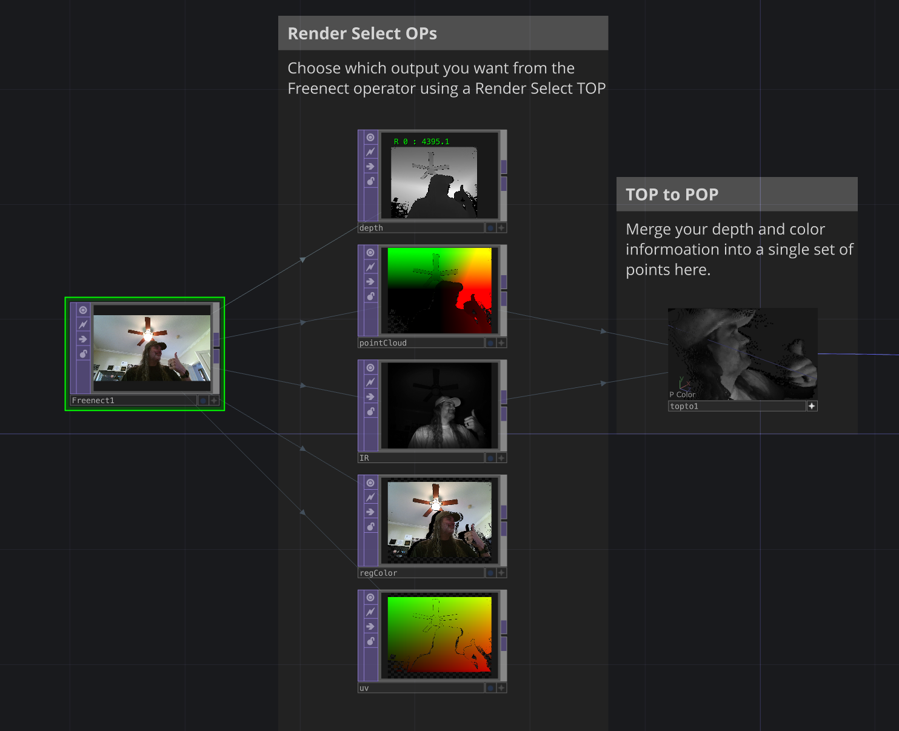

# FreenectTD

FreenectTD is an open-source TouchDesigner plugin aimed at macOS users who don't have a way to use the official Kinect OPs in TouchDesigner.

It leverages [libfreenect](https://github.com/OpenKinect/libfreenect) and [libfreenect2](https://github.com/OpenKinect/libfreenect2) to implement support for Kinect cameras.

**[Website](https://marte.ee/freenecttd/) · [Docs](https://marte.ee/freenecttd/docs) · [Download](https://marte.ee/freenecttd/download) · [Changes](https://marte.ee/freenecttd/changes)**

### Requirements
* Apple Silicon Mac
* macOS 12.4+ (Monterey)
* TouchDesigner 2025.33230+ (any license)
* Kinect V1 / Kinect V2

### Supported features
| Feature                                              | Kinect V1 | Kinect V2 |
| ---------------------------------------------------- | --------- | --------- |
| RGB streaming                                        | ✅         | ✅         |
| Depth map streaming                                  | ✅         | ✅         |
| Point cloud map streaming                            | ❌         | ✅         |
| IR streaming                                         | ✅*        | ✅         |
| Tilt control                                         | ✅         | ❌         |
| Depth undistortion                                   | ❌         | ✅         |
| Depth registration (align depth map to color)        | ✅         | ✅         |
| Manual depth range                                   | ✅         | ✅         |
| Depth output in millimeters / meters                 | ✅         | ✅         |
| RGB-aligned point cloud, registered color and UV map | ❌         | ✅         |

\* On Kinect V1, IR turns RGB off: the V1 doesn't have the bandwidth to stream both at once.

## Donations
If you like FreenectTD, please consider donating to support further development!

 

## Credits

Thanks to everyone who contributed:
- [@dcheesman](https://github.com/dcheesman): point cloud registration, float depth, POP workflow ([#25](https://github.com/stosumarte/FreenectTD/pull/25))
- [@gcarizza](https://github.com/gcarizza): Kinect V1 depth stream fix ([#21](https://github.com/stosumarte/FreenectTD/pull/21))
- [@fedevoxlive](https://github.com/Fedevoxlive): Kinect V1 IR streaming ([#22](https://github.com/stosumarte/FreenectTD/pull/22))

A very big thank you goes to the OpenKinect project, who developed the libraries that made this plugin possible.

## Licensing

**FreenectTD** is licensed under the **GNU Lesser General Public License v2.1 (LGPL-2.1)**.  
This means you are free to use, modify, and distribute this plugin, including in closed-source applications, provided that any modifications to the plugin itself are released under the same LGPL v2.1 license.

This project also includes the following third-party libraries, each under their respective licenses:

- **libfreenect** – Apache 2.0 License  
  [Full License Text](https://raw.githubusercontent.com/OpenKinect/libfreenect/master/APACHE20)

- **libfreenect2** – Apache 2.0 License  
  [Full License Text](https://raw.githubusercontent.com/OpenKinect/libfreenect2/master/APACHE20)

- **libusb** – LGPL 2.1 License  
  [Full License Text](https://raw.githubusercontent.com/libusb/libusb/master/COPYING)

By downloading, using, modifying, or distributing this plugin, either as source-code or binary format, you agree to comply with the terms of both the **LGPL-2.1** license for the plugin itself and the respective licenses of the third-party libraries included.
