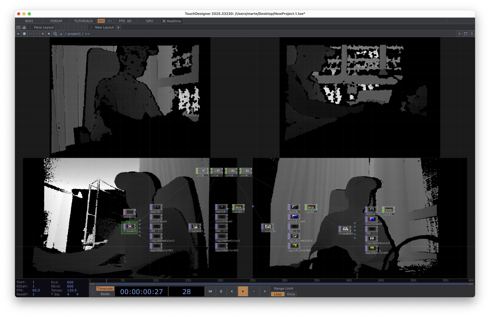

# FreenectTD
[](https://github.com/stosumarte/FreenectTD/releases/latest)
[](https://github.com/stosumarte/FreenectTD/releases)
[](https://github.com/stosumarte/FreenectTD/stargazers)
[](LICENSE)

FreenectTD is an open-source TouchDesigner plugin aimed at macOS users who don't have a way to use the official Kinect OPs in TouchDesigner.

It adds a Freenect TOP that streams RGB, depth, IR and point clouds from Kinect V1 and V2, using [libfreenect](https://github.com/OpenKinect/libfreenect) and [libfreenect2](https://github.com/OpenKinect/libfreenect2). Kinect V2 depth is decoded on the GPU with Metal.

<a href="https://github.com/stosumarte/FreenectTD/releases/latest/download/FreenectTOP_Installer.pkg"></a>

### [Installing](#installing) · [Usage](#usage) · [Multiple Kinects](#multiple-kinects) · [FAQ](#faq) · [Releases](https://github.com/stosumarte/FreenectTD/releases)


### Requirements
* Apple Silicon Mac
* macOS 12.4+ (Monterey)
* TouchDesigner 2025.33230+ (any license)
* One or more Kinect V1 (Xbox 360) / Kinect V2 (Xbox One)

### Supported features
| Feature | Kinect V1 | Kinect V2 |
| --- | :-: | :-: |
| RGB streaming | ✅ | ✅ |
| Depth map streaming | ✅ | ✅ |
| Point cloud map streaming | ❌ | ✅ |
| IR streaming | ✅* | ✅ |
| Tilt control | ✅ | ❌ |
| Depth undistortion | ❌ | ✅ |
| Depth registration (align depth map to color) | ✅ | ✅ |
| Manual depth range | ✅ | ✅ |
| Depth output in millimeters / meters | ✅ | ✅ |
| RGB-aligned point cloud, registered color and UV map | ❌ | ✅ |
| Multiple Kinects, one per node | ✅ | ✅ |

\* On Kinect V1, IR turns RGB off: the V1 doesn't have the bandwidth to stream both at once.

## Installing

### Using the installer (recommended)

1. [Download the latest installer build](https://github.com/stosumarte/FreenectTD/releases/latest/download/FreenectTOP_Installer.pkg)
2. Right click on `FreenectTOP_Installer.pkg` and select "Open"

You should now find Freenect TOP in the "Custom" tab of the OP Create Dialog.

> [!TIP]
> If the installer gets blocked from running, go to `System Settings > Privacy & Security` and click on `Open Anyway`.

### Manually

1. [Download the latest zip build](https://github.com/stosumarte/FreenectTD/releases/latest/download/FreenectTOP.zip) and unzip it.
2. Copy `FreenectTOP.plugin` to:
   * **all projects:** `~/Library/Application Support/Derivative/TouchDesigner099/Plugins` (press `⌘⇧.` in Finder to show the hidden Library folder)
   * **one project:** a folder named `Plugins` next to your .toe

Older versions are on the [releases page](https://github.com/stosumarte/FreenectTD/releases).

### Uninstalling

```sh
sudo rm -rf ~/Library/Application\ Support/Derivative/TouchDesigner099/Plugins/Freenect*.plugin
```

## Usage

Freenect TOP outputs RGB. To get the other streams, use Render Select TOPs set to their index:

| Index | Stream | Format |
| :-: | --- | --- |
| 0 | RGB | RGBA8 |
| 1 | Depth | Mono16 (Normalized) or Mono32F (mm / m) |
| 2 | Point cloud (V2) | RGBA32F: XYZ in meters, A = 1 if valid |
| 3 | IR | Mono16 |
| 4 | Registered color (V2) | RGBA8: RGB on the depth grid, A = 0 where there is no color |
| 5 | Depth→color UV map (V2) | RGBA32F: (u, v, 0, valid) into RGB, for a Remap TOP |

| Resolution | Kinect V1 | Kinect V2 |
| --- | --- | --- |
| RGB | 640x480 | 1920x1080 (1280x720 on Non-Commercial) |
| Depth, point cloud | 640x480 | 512x424, or RGB's size when Registered |
| IR, registered color, UV map | 640x480 | 512x424 |

Sizes and formats are fixed: the Common page's Output Resolution and Pixel Format have no effect. To scale, use a Resolution TOP, with Input Smoothness = Nearest Pixel for depth and point cloud.

Example .toe projects are in [`toe_examples`](toe_examples).

### Parameters

**Device**

| Parameter | Description |
| --- | --- |
| Active | Off closes the Kinect. |
| Device | Auto opens the first Kinect no other node is using. Pick a Kinect to always use it. See [Multiple Kinects](#multiple-kinects). |
| Tilt Angle (V1) | Motor tilt. |

**Streams**

| Parameter | Description |
| --- | --- |
| Stream toggles | Turn streams 1–5 on or off. On V1, RGB and IR share one stream: RGB is blank while IR is on. |

**Depth**

| Parameter | Description |
| --- | --- |
| Depth Format | Space of depth and point cloud. Raw: depth camera. Raw Undistorted: depth camera without lens distortion (V2). Registered: color camera, pixel-aligned with RGB. |
| Depth Output | Normalized (16-bit), Millimeters or Meters (32-bit float). |
| Manual Depth Range, Depth Range Min/Max | Valid depth window in mm, up to 8000. When off: 400–4500 on V1, 500–4500 on V2. The V2 is rated to 4.5 m and gets noisier beyond. |
| Unknown Depth, Unknown Depth Value | Written where there's no reading or it's out of range. Zero; Far, the end of the range (1 in Normalized, Depth Range Max in mm / m); or Custom, the Unknown Depth Value in Depth Output units (clamped to 0–1 in Normalized). |

**Point Cloud (V2)**

| Parameter | Description |
| --- | --- |
| Point Cloud Flip X/Y/Z | The native frame is +Y up, +Z away from the sensor. Flip Z suits a TouchDesigner camera looking down -Z. |
| Unknown Point Value | XYZ of invalid points. Their alpha stays 0, so alpha is the validity mask. |

**About**

| Parameter | Description |
| --- | --- |
| Check for Updates | Shows the latest GitHub release in a dialog. |
| Open Releases Page | Opens the releases on GitHub. |
| Support FreenectTD | Opens the donation page. |

### Colored point cloud (Kinect V2)

| Depth Format | Point cloud (stream 2) is in | Color it with |
| --- | --- | --- |
| Registered | the color camera, pixel-aligned with RGB | RGB (stream 0), by pixel position |
| Raw | the depth camera | Registered color (stream 4) directly, or the UV map (stream 5) to sample full-resolution RGB with a Remap TOP |

The two spaces are offset by the distance between the cameras (about 5 cm), so don't mix them in one render.

To render it as a POP:

1. Add a TOP to POP on stream 2 with *First RGBA Contains* = `Position and Active`.
2. Add a second TOP block reading the color (stream 4 for Raw, stream 0 for Registered) into `Color`, with *Filter* = `Nearest Pixel`.
3. Render it with a Constant MAT with *Apply Point Color* on.

[`toe_examples/FreenectTOP_PointCloud_Example.toe`](toe_examples/FreenectTOP_PointCloud_Example.toe) contains this network.

### Status

Middle-click the node for its Kinect (including the one Auto picked) and status: inactive, no Kinect, initializing, streaming or error. Scripts can read the same from an Info DAT or Info CHOP.

| Info DAT row | Description |
| --- | --- |
| `kinect` | The Kinect in use. |
| `id` | Its Device menu value. |
| `status` | As in the info popup. |
| `pipeline` | Where V2 depth is decoded: Metal (GPU), or CPU if Metal isn't usable. Empty on V1. |

| Info CHOP channel | Description |
| --- | --- |
| `streaming` | 0 or 1. Use it to switch to fallback content when a Kinect drops out. |
| `connected` | 0 or 1. |
| `version` | 0 (none), 1 or 2. |
| `depth_fps` | Depth frames per second. On V1, at most one per cook. |
| `rgb_fps` (V2) | Color frames per second. |
| `process_ms` (V2) | Time spent per frame: below 33 for 30 fps. |

## Multiple Kinects

Each Freenect TOP opens one Kinect, and each Kinect is open in one node at a time. Any mix of V1 and V2 works.



*Device* = Auto skips Kinects that other nodes have open or have picked, and moves on if another node picks its Kinect. A picked Kinect is found by serial number across restarts and USB ports; if it's unplugged it stays in the menu as not connected, and reopens when it's back. A node whose Kinect is taken says which node has it.

The Device menu lists each Kinect as version, model and serial number, e.g. `v2 (One) [504521442542]`. V1 models are 1414, 1473 and K4W; V2 models are K4W and One. The model is read from the USB product ID, which may differ between units: treat it as a hint.

### USB

* **Kinect V2:** needs most of a USB 3 controller. Give each V2 its own controller where you can.
* **Two Kinect V1:** on the same USB bus they don't stream reliably: the one opened last keeps dropping out. Plug each into its own port on the Mac.
* **Hubs:** unplugging one Kinect can make some hubs drop the others for a moment; they reconnect by themselves. Use one port per Kinect, or a hub that doesn't reset its other ports.

## FAQ

**How does it work without Microsoft's Kinect SDK?**  
Freenect TOP talks to the Kinect over USB with open-source drivers: our forks of [libfreenect](https://github.com/stosumarte/libfreenect/tree/freenecttd) for V1 and [libfreenect2](https://github.com/stosumarte/libfreenect2/tree/metal) for V2. They're bundled in the plugin, so there's nothing else to install.

**TouchDesigner asks "Allow this plugin to be loaded?"**  
It does for every plugin it hasn't seen before: click OK.

**The Kinect OPs say "not supported on this operating system".**  
FreenectTD doesn't make TouchDesigner's built-in Kinect OPs work on macOS, nor components built on them. It adds its own operator, Freenect TOP, in the Custom tab of the OP Create Dialog.

**Freenect TOP doesn't find my Kinect.**  
Check that the Mac sees it: hold Option, choose `Apple menu > System Information` and open USB. Look for Microsoft devices such as `Xbox NUI Camera` (V1) or `Xbox NUI Sensor` (V2). If it's missing, or a V1 only shows `Xbox NUI Motor`, check the Kinect's power adapter and try another port, cable or adapter. If it's listed, another Freenect TOP may have it open: that node says so.

**Does it run on Intel Macs?**  
No, and it isn't planned. Apple is phasing out Intel, and software built for two architectures is much harder to maintain.

**A Kinect keeps dropping out.**  
Usually it's USB: see [USB](#usb).

**Render Select TOPs stop updating.**  
Like every TOP, Freenect TOP only cooks when something uses its output. In perform mode or another network, end the chain in a Null TOP with its display flag on.

**Kinect V2 depth runs at 15 fps.**  
In low light the color camera slows to 15 fps, and depth with it, since each depth frame pairs with a color frame. If `rgb_fps` is also around 15, add light.

**Why is the Kinect V1 IR image covered in dots?**  
It's the pattern the laser projector casts to measure depth. This is expected.

**Why is Kinect V2 RGB 1280x720?**  
TouchDesigner's Non-Commercial license caps textures at 1280x1280, so Kinect V2 RGB, and the outputs that follow it, are scaled down from 1920x1080.

## Known limitations

* Skeleton tracking is currently impossible to implement.
* Tilt control may not work with some V1 models (1473 and Kinect for Windows V1). This is due to a mix of different factors in libfreenect and Kinect official firmware.
* Closing a Kinect V2 restarts it, so switching to it or reopening it takes a few seconds.

## Building

Open `FreenectTD.xcodeproj` and build the `FreenectTOP` target; the project also builds the installer. The libraries it links are prebuilt in `include/`. To rebuild them from the submodules in `external/` (libusb and our forks of [libfreenect](https://github.com/stosumarte/libfreenect/tree/freenecttd) and [libfreenect2](https://github.com/stosumarte/libfreenect2/tree/metal)), run `git submodule update --init` and `utils/build_dependencies.sh`; it needs full Xcode and CMake.

Bugs and feature requests go in the [issue tracker](https://github.com/stosumarte/FreenectTD/issues). Pull requests are welcome.

## Donations
If you like FreenectTD, please consider donating to support further development!

<a href='https://ko-fi.com/H2H318LODL' target='_blank'>

</a>
</br>
<a href="https://www.paypal.com/donate/?hosted_button_id=PZXS4BCQJ9QMQ" target="_blank" style="text-decoration:none!important;">

</a>

## Credits

Thanks to everyone who contributed:
- [@dcheesman](https://github.com/dcheesman): point cloud registration, float depth, POP workflow ([#25](https://github.com/stosumarte/FreenectTD/pull/25))
- [@gcarizza](https://github.com/gcarizza): Kinect V1 depth stream fix ([#21](https://github.com/stosumarte/FreenectTD/pull/21))
- [@fedevoxlive](https://github.com/Fedevoxlive): Kinect V1 IR streaming ([#22](https://github.com/stosumarte/FreenectTD/pull/22))

A very big thank you goes to the OpenKinect project, who developed the libraries that made this plugin possible, and to Harold Martin ([@hbmartin](https://github.com/hbmartin)), whose Metal depth pipeline from [libfreenect2-metal](https://github.com/hbmartin/libfreenect2-metal) decodes Kinect V2 depth on the GPU.

## Licensing

**FreenectTD** is licensed under the **GNU Lesser General Public License v2.1 (LGPL-2.1)**.  
This means you are free to use, modify, and distribute this plugin, including in closed-source applications, provided that any modifications to the plugin itself are released under the same LGPL v2.1 license.

This project also includes the following third-party libraries, each under their respective licenses:

- **libfreenect** ([our fork](https://github.com/stosumarte/libfreenect/tree/freenecttd), with a fix for macOS 26) – Apache 2.0 License  
  [Full License Text](https://raw.githubusercontent.com/OpenKinect/libfreenect/master/APACHE20)

- **libfreenect2** ([our fork](https://github.com/stosumarte/libfreenect2/tree/metal), with Harold Martin's Metal depth pipeline) – Apache 2.0 License  
  [Full License Text](https://raw.githubusercontent.com/OpenKinect/libfreenect2/master/APACHE20)

- **libusb** – LGPL 2.1 License  
  [Full License Text](https://raw.githubusercontent.com/libusb/libusb/master/COPYING)

By downloading, using, modifying, or distributing this plugin, either as source-code or binary format, you agree to comply with the terms of both the **LGPL-2.1** license for the plugin itself and the respective licenses of the third-party libraries included.

> FreenectTD is not affiliated with Microsoft or Derivative. Kinect, Xbox, TouchDesigner and macOS are trademarks of their respective owners.
